# Relay · 即应中间件

[](https://go.dev/)
[](https://github.com/2379278408/jiying-middleware/actions/workflows/ci.yml)
[](https://github.com/2379278408/jiying-middleware/releases/latest)
[](https://www.gnu.org/licenses/agpl-3.0.html)

把即应接进团队的工作流。

Relay 是即应（Jiying）的自动化中间件与控制台。它接住即应的应用通道与账号通道，把聊天、定时任务和 Webhook 归一成一条任务队列，调用内置、HTTP 或脚本功能执行，再把结果发回原会话。

即应负责「沟通与协作」，Relay 负责「接入、执行与治理」：多应用多账号、可靠事件消费、插件生态、AI 工具调用、权限隔离、审计与可观测，都在这里完成。

- 双通道接入，事件按 cursor 去重、确认与重放。
- 聊天、定时、Webhook 统一排队，插件与 Agent 共用一套功能目录。
- 角色、归属、审计与指标内置，适合直接交给团队运维。

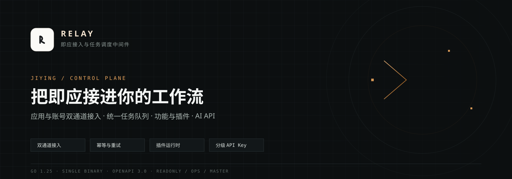

## 关于即应

[即应](https://jiying.chat/) 是一款开源的团队智能协作应用，由北京长亭科技有限公司开发。它把即时沟通、AI 助理、项目、任务与文档放进同一个工作空间，支持 Web、Windows、macOS、Linux、Android 与 iOS，支持官方服务与团队私有化部署。

即应核心代码以 AGPL-3.0 开源，所有 API 向开发者开放，AI 可以在用户授权范围内调用消息、项目、任务与文档能力，也可以通过 MCP 连接外部工具。官网将它定位为「AI 时代的团队协作入口」与飞书、钉钉、企业微信的开源平替。

| 资源 | 地址 |
| --- | --- |
| 官方网站 | https://jiying.chat/ |
| 在线体验 | https://app.jiying.chat/ |
| 开源仓库 | https://github.com/chaitin/MagicChat |
| 部署文档 | https://jiying.docs.baizhi.cloud/ |
| iOS 客户端 | https://apps.apple.com/cn/app/%E5%8D%B3%E5%BA%94-ai/id6793547066 |

本仓库是构建在即应开放能力之上的独立中间件项目，与即应官方仓库相互独立。

## 为什么需要 Relay

即应已经解决了团队在哪里沟通、AI 如何参与协作。真实团队还会遇到另一类问题：业务系统怎么接进来，定时与 Webhook 怎么统一排队，脚本和插件怎么安全运行，外部 AI 怎么在受控范围内调用能力，出了问题怎么审计和定位。

Relay 补齐这一层执行面：

| 即应负责 | Relay 负责 |
| --- | --- |
| 消息、会话、项目与任务 | 应用与账号双通道接入、事件确认与重放 |
| AI 助理与开放 API | 功能目录、任务队列、插件运行时与 Agent 工具 |
| 成员、权限与协作空间 | API Key 分级、任务归属隔离、审计与指标 |

## 适用场景

- **团队自动化**：把定时提醒、日报汇总、签到、告警和 Webhook 处理统一进即应会话，结果回到原话题。
- **业务系统接入**：用 HTTP 功能连接内部系统，不必把每个系统的协议都塞进聊天客户端。
- **插件开发与分发**：用 JavaScript 或 Python 写功能，声明配置 schema 与权限，通过插件市场签名分发。
- **AI 与 Agent 接入**：把已授权功能映射成工具，让模型选功能、填参数，执行仍走可审计的队列。
- **团队运维**：用角色、任务归属、审计、健康检查与 Prometheus 指标管理接入和运行状态。

## 核心能力

### 接入与可靠性

- 应用通道与账号通道双身份接入，事件按 cursor 去重、确认与重放。
- 断线指数退避重连，重连后由服务端补发未确认事件，业务成功后才推进 ack 水位。
- 聊天、定时、Webhook 统一任务队列，支持确认卡片、超时、重试与失败停用。
- 连接池支持多应用、多账号与默认出口，旧单连接配置自动迁移。

### 扩展与自动化

- 内置 / HTTP / 脚本三类功能，插件支持 `[config: ...]` 配置 schema。
- 插件市场使用 Ed25519 发布者签名，安装前校验签名与内容摘要，禁止静默降级。
- Python 脚本在独立工作目录执行，带环境变量白名单、CPU/内存/输出限制，`[network: false]` 使用无网络命名空间。
- Agent 把功能目录映射为工具，模型只负责选功能与填参数，执行仍走可审计的任务队列。
- Agent 可配置轮次、工具调用次数与上下文预算，超预算时裁剪历史并停止下发工具定义。

### 治理与可观测

- API Key 分 readonly / ops / master 三档，公开 AI 文档按 scope 裁剪。
- 任务与定时按归属隔离：主控可见全部，其他身份只能查看和操作自己创建的任务。
- 危险操作写审计，审计 URL 会剥离 userinfo 与查询参数中的凭据。
- 控制台覆盖会话、消息发送、媒体上传、功能、插件、技能、定时、执行记录、审计与运行日志。
- `/healthz`、`/readyz`、`/metrics` 输出存活、就绪与任务排队等待、执行耗时、终态计数。

## 界面

登录入口。应用通道与账号通道未就绪时，控制台会直接给出修复项。

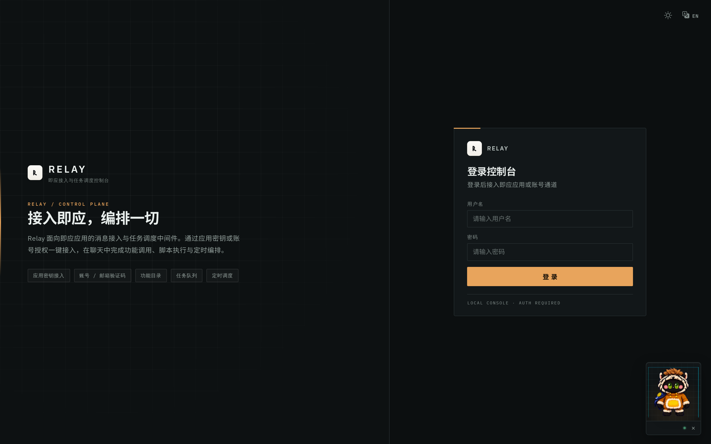

深色模式：

<table>
  <tr>
    <td width="50%">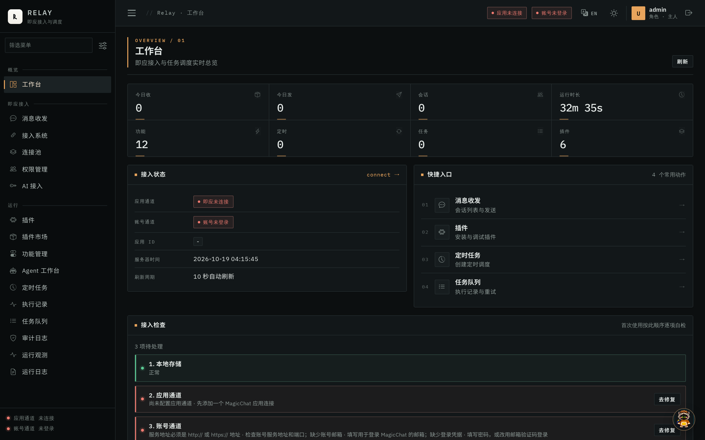</td>
    <td width="50%">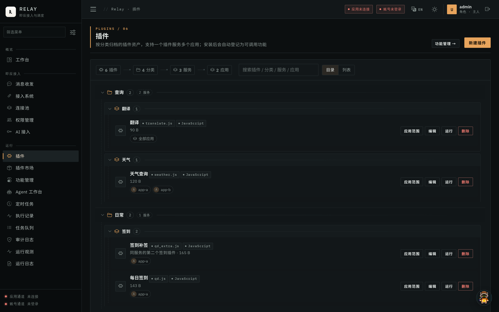</td>
  </tr>
  <tr>
    <td>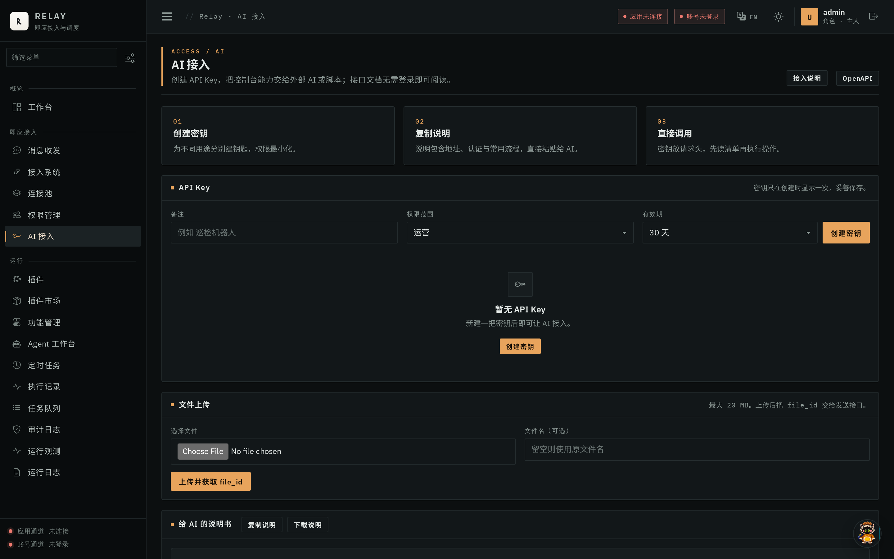</td>
    <td>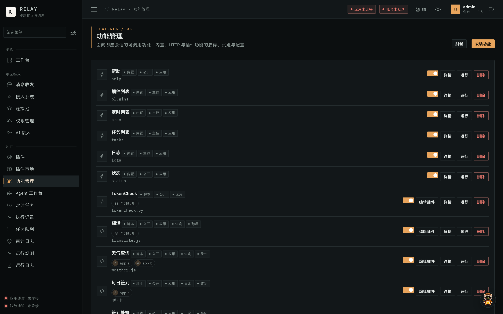</td>
  </tr>
</table>

白天模式：

<table>
  <tr>
    <td width="50%">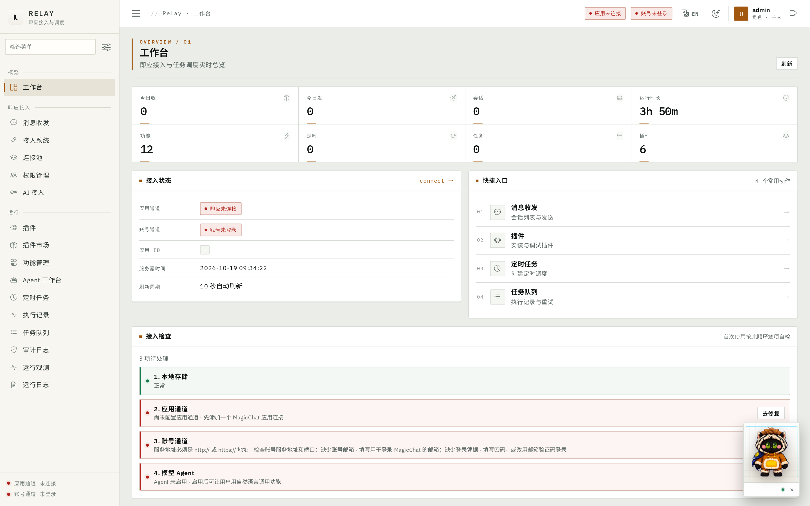</td>
    <td width="50%">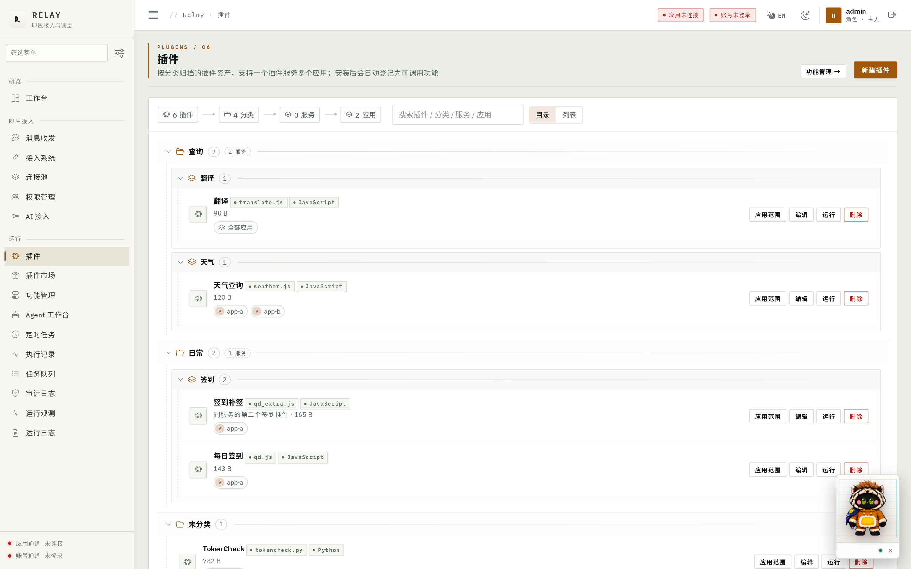</td>
  </tr>
  <tr>
    <td>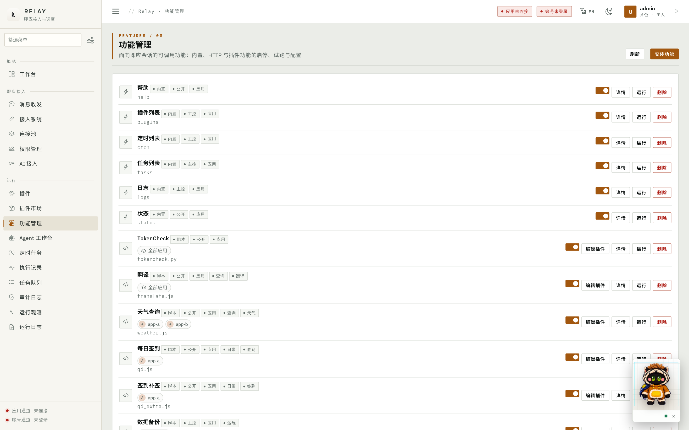</td>
    <td>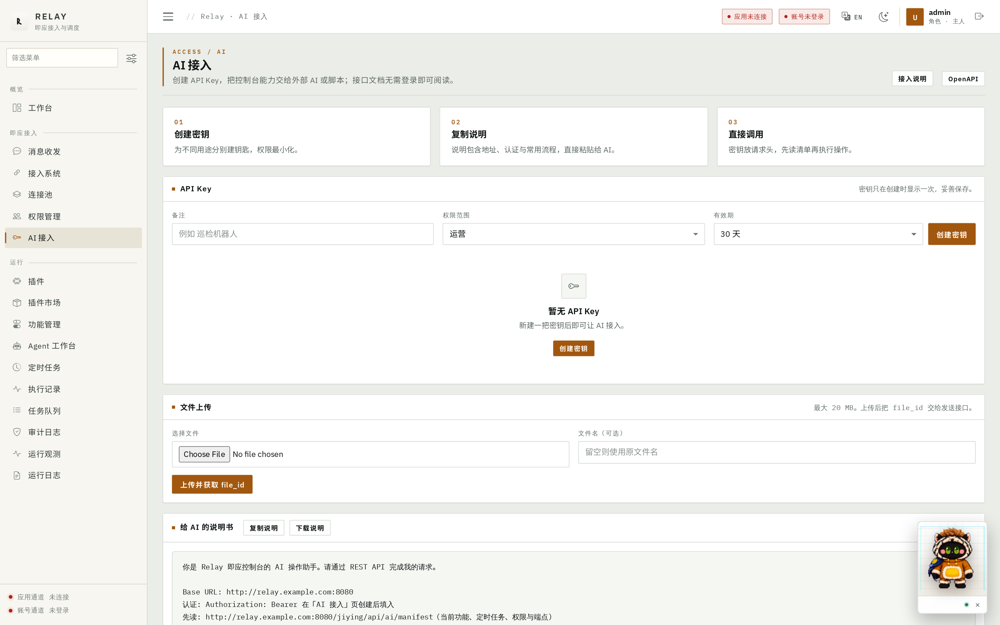</td>
  </tr>
</table>

## 运行架构

即应的事件进入接入层，归一后写入统一任务队列，由执行器调用内置、HTTP 或脚本功能，结果回发会话并写入执行账本。控制台覆盖连接、插件、定时、AI Key、审计与运行观测。

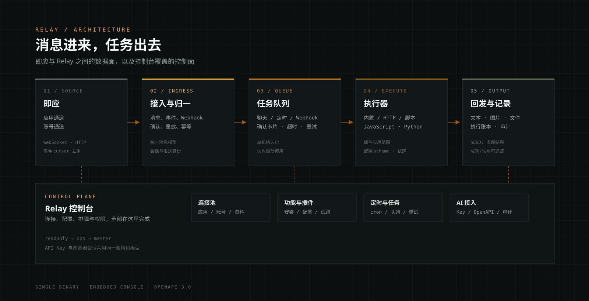

```text
即应应用 / 账号
      │  WebSocket / HTTP
      ▼
  接入与归一  ──  cursor 去重、确认、重放
      │
      ▼
   任务队列  ──  聊天 / 定时 / Webhook / 确认卡片 / 超时重试
      │
      ├── 内置功能
      ├── HTTP 功能
      └── 脚本与插件  ──  JS / Python / 沙箱
      │
      ▼
  结果回发 + 执行账本 + 审计 + 指标
```

控制面与数据面分离：控制台只负责配置、授权与排障，真正的消息处理和任务执行始终走同一条队列，避免出现「页面点了但任务没跑」的状态分裂。

## 快速开始

### 1. 环境要求

- Linux amd64（发布包）或 Go 1.25 或更新版本（源码编译）
- 可访问的即应服务（应用身份或账号身份）
- 生产环境建议准备反向代理与 HTTPS 证书

如果还没有即应服务，可以参考[即应部署文档](https://jiying.docs.baizhi.cloud/)启动一套，或先在[在线体验](https://app.jiying.chat/)了解产品形态。

### 2. 使用发布包

前往 [Releases](https://github.com/2379278408/jiying-middleware/releases/latest) 下载最新的 `jiying-middleware-*-linux-amd64.tar.gz`：

```bash
mkdir relay
tar -xzf jiying-middleware-*-linux-amd64.tar.gz -C relay
cd relay
JIYING_DATA=./data ./jymw
```

发布包已包含 `views2/assets`，解压即可运行，默认监听 `0.0.0.0:8080`。

### 3. 从源码编译

```bash
# 编译
go build -o dist/jymw .

# 控制台静态资源需要与可执行文件放在同一资源目录
mkdir -p dist/views2
cp -R views2-patch/assets dist/views2/

# 启动，默认监听 0.0.0.0:8080
./dist/jymw
```

自定义资源目录与数据目录：

```bash
JIYING_RES=/opt/jiying JIYING_DATA=/var/lib/jiying JIYING_PORT=8080 ./jymw
```

`JIYING_RES` 默认是可执行文件所在目录，`JIYING_DATA` 默认与资源目录相同。日志位于 `<数据目录>/logs/YYYYMMDD.log`，脚本、插件、存储桶也落在数据目录下。

端口优先级为控制台配置 `port` > 环境变量 `JIYING_PORT` > 默认 `8080`；监听 `443` 时启用 TLS，需要在控制台配置 `certFile` 与 `keyFile`。其余端口按 HTTP 启动，生产环境建议由反向代理终止 TLS。

### 4. 接入即应

在即应管理端创建应用，取得应用 ID 与连接密钥，然后启动 Relay：

```bash
export JIYING_WS_URL='wss://<host>/api/app/ws'
export JIYING_APP_ID='<应用 ID>'
export JIYING_APP_SECRET='<应用连接密钥>'
./jymw
```

源码构建时将 `./jymw` 换成 `./dist/jymw`。也可以启动后登录控制台，在「接入系统」或「连接池」中填写应用地址、应用 ID 与密钥。账号通道使用邮箱密码或验证码登录，两者可以同时接入。

首次启动会生成管理员引导口令，写入 `<数据目录>/admin-initial-password.txt`；首次登录成功后该文件自动删除。需要固定口令时设置 `JIYING_ADMIN_PASSWORD`。

### 5. Docker

```bash
# 构建镜像
docker build -t jiying/jymw:latest .

# 启动，数据目录必须持久化
docker run -d --name jymw --restart unless-stopped \
  -p 127.0.0.1:8080:8080 \
  -v /srv/jiying:/data \
  --env-file /etc/jiying/jiying.env \
  jiying/jymw:latest
```

镜像内已安装 Python、`prlimit`、`unshare` 与 CA 证书。脚本沙箱依赖内核允许非特权用户命名空间；受限内核上会直接失败关闭。

### 6. 生产部署

单实例部署、反向代理、备份恢复、告警与多实例边界见 `docs/production.md`。

## 配置

连接参数通过环境变量或控制台提供，不写入仓库：

| 环境变量 | 默认值 | 说明 |
| --- | --- | --- |
| `JIYING_WS_URL` | 无 | 即应应用通道地址，如 `wss://host/api/app/ws` |
| `JIYING_APP_ID` | 无 | 即应应用 ID |
| `JIYING_APP_SECRET` | 无 | 即应应用连接密钥 |
| `JIYING_RES` | 可执行文件目录 | 静态资源目录，必须包含 `views2/` |
| `JIYING_DATA` | 同 `JIYING_RES` | 数据、日志、脚本、插件与存储桶 |
| `JIYING_PORT` | `8080` | HTTP 监听端口 |
| `JIYING_SECRET_KEY` | 自动生成 | 连接密钥加密密钥，32 字节 hex 或 base64 |
| `JIYING_ADMIN_PASSWORD` | 自动生成 | 固定管理员口令；不设置则写入一次性引导文件 |
| `JIYING_ALLOW_PRIVATE_HOSTS` | `0` | 允许出站访问回环、私网与云元数据地址 |
| `JIYING_PPROF` | `0` | 开启 pprof 调试端点，仅限受信任环境 |
| `JIYING_DEBUG` | `0` | 开启 Gin 调试日志 |
| `JIYING_RANK3_KEY` / `JIYING_RANK4_KEY` | 无 | rank 编码密钥，未配置时相关编码失败关闭 |

连接密钥在 bbolt 中以 `enc:v1:` 前缀密文存储。本地加密密钥优先读取 `JIYING_SECRET_KEY`，否则使用 `<数据目录>/.relay_secret_key`（0600，首次自动生成）。丢失该密钥会导致已存连接密钥无法解密，需要重新配置。

调试端点默认关闭；只在受信任的本机环境临时开启：

```bash
JIYING_PPROF=1 ./jymw
```

Gin 默认以发布模式运行，排障时再显式打开调试日志：

```bash
JIYING_DEBUG=1 ./jymw
```

出站连接默认拒绝回环、私网与云元数据地址；确认部署在内网且需要访问内网服务时：

```bash
JIYING_ALLOW_PRIVATE_HOSTS=1 ./jymw
```

rank 编码使用部署侧密钥：

```bash
export JIYING_RANK3_KEY='<32 字节以上随机串>'
export JIYING_RANK4_KEY='<32 字节以上随机串>'
```

## 项目结构

| 路径 | 说明 |
| --- | --- |
| `core/` | 事件接入、任务队列、功能与插件运行时、Agent、审计、指标 |
| `develop/` | HTTP 路由、登录、用户与 bbolt 兼容层 |
| `views2-patch/assets/` | 控制台前端资源（原生 JavaScript / CSS） |
| `deploy/` | systemd 单元与部署辅助文件 |
| `docs/` | 开发方案、生产部署与调研文档 |
| `Dockerfile` | 多阶段构建，运行镜像内置 Python 与沙箱工具 |
| `main.go` | 程序入口 |

## 媒体上传

`POST /jiying/api/upload`（运营及以上）支持 multipart 字段 `file`，或表单字段 `name`、`content_type`、`data_base64`，单文件最大 20 MB。返回的 `file_id` 可直接用于 `/jiying/api/send/file`。

## 文档与接口

- 开发方案与实现记录：`docs/jiying-middleware.md`
- 生产部署、Docker、反向代理、备份恢复、告警与多实例边界：`docs/production.md`
- AI 接入说明：`GET /jiying/ai.txt`（无需登录）
- OpenAPI：`GET /jiying/openapi.json`（无需登录）
- 能力清单：`GET /jiying/api/ai/manifest`（需登录或 API Key）
- 健康检查：`GET /healthz`、`GET /readyz`、`GET /metrics`

API Key 在控制台「AI 接入」页创建，明文只显示一次。权限从低到高为只读、运营、主人；密钥管理只接受主人账号的浏览器会话。

## 安全设计

- 连接密钥以 `enc:v1:` 密文落盘，API Key 只保存哈希，页面不回显已存密钥。
- 出站请求默认拒绝回环、私网与云元数据地址，脚本可关闭网络命名空间。
- 插件安装校验 Ed25519 签名与内容摘要，插件配置中的 `secret` 字段只返回是否已设置。
- 公开 AI 文档按 API Key 角色裁剪；任务与定时按归属隔离，危险操作写审计。
- 审计记录会剥离 URL 中的 userinfo 与敏感查询参数。

## 常见问题

**Relay 是即应官方项目吗？**

Relay 是独立项目，通过即应开放的应用通道、账号通道与 API 接入，不修改即应本体。

**需要改即应服务端吗？**

不需要。在即应管理端创建应用，或使用账号登录即可；两者可以同时接入。

**支持多实例吗？**

同一 `appID` 应只运行一个写入实例。多实例的共享存储与去重边界见 `docs/production.md`。

**支持哪些脚本？**

JavaScript 在 goja 运行时执行，Python 以独立进程执行；两者都支持插件配置 schema 与沙箱限制。

**数据存在哪里？**

默认落在 `JIYING_DATA`，包括 bbolt 存储桶、脚本、插件、日志与加密密钥文件。

## 测试

```bash
gofmt -l .
go build ./...
go vet ./...
go test ./...
```

需要并发相关回归时：

```bash
go test -race -count=1 ./core
```

## 参与贡献

开发环境、测试命令与提交约定见 `CONTRIBUTING.md`。安全问题请不要公开提交 issue，按 `SECURITY.md` 私下报告。

## 许可证

本项目以 [AGPL-3.0](https://www.gnu.org/licenses/agpl-3.0.html) 许可证开源，完整文本见 `LICENSE`。
